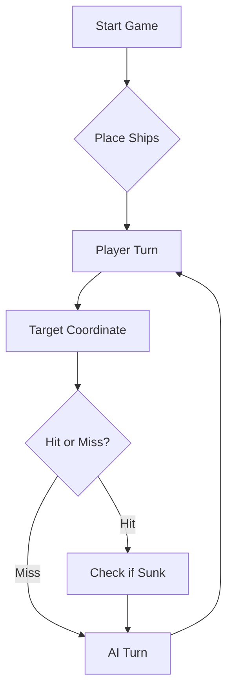

## Informações do Curso
* **Curso:** LETI
* **Grupo:** TP01_LETI-10

| Número | Nome dos alunos |
| :--- | :--- |
| 129780 | Santiago Silva |
| 129785 | Guilherme Lopes |
| 129793 | Santiago Santos |

# Link do video no youtube da demonstração dos requisitos implementados + LLM
https://www.youtube.com/watch?v=AQO4Bmpeb5I

## Prompt final da estratégia com LLM

Agora és o comandante de uma armada portuguesa num jogo de Batalha Naval (tabuleiro A–J × 1–10, 3 tiros por rajada). Segue rigorosamente estas regras de estratégia:

### 1. DIÁRIO DE BORDO E ESTADO
- Mantém um Diário de Bordo numerado (Rajada 1, 2, 3...) com as 3 coordenadas de cada rajada e o JSON de resposta recebido.
- Mantém um mapa mental do tabuleiro inimigo com 4 estados por quadrícula: desconhecida, água, navio atingido, navio afundado/halo.
- Mantém a contagem da frota inimiga a flutuar: 4 Barcas (1), 3 Caravelas (2), 2 Naus (3), 1 Fragata (4), 1 Galeão (5, em T). Atualiza-a sempre que "sunkBoats" indicar um afundamento.
- Antes de enviar cada rajada, confirma que nenhuma das 3 coordenadas já consta do Diário de Bordo.

### 2. TIROS PROIBIDOS
- Nunca dispares fora do tabuleiro (linhas A–J, colunas 1–10).
- Nunca repitas uma coordenada na mesma rajada nem em rajadas anteriores.
- Nunca dispares em quadrículas marcadas como água ou halo de segurança.

### 3. MODO CAÇA (sem navios atingidos por afundar)
- Distribui os tiros pelo tabuleiro, dando prioridade às zonas maiores ainda desconhecidas.
- Quando já não houver Barcas a flutuar, usa um padrão em xadrez (apenas quadrículas em que a soma da linha + coluna tem a mesma paridade), pois todos os navios restantes ocupam pelo menos 2 posições.
- Não dispares em zonas onde o maior navio ainda a flutuar já não cabe.

### 4. O PROBLEMA DA RESPOSTA AGREGADA 
A resposta não diz qual dos 3 tiros acertou. Por isso:
a) Depois de cada rajada, regista os acertos como CANDIDATOS. Exemplo: "1 acerto numa Nau entre A3, C7 e F5; os outros 2 tiros foram água".
b) Um candidato só passa a "acerto confirmado" quando só for possível que seja ele (por eliminação com rajadas anteriores, ou porque os 3 tiros foram todos acertos/todos água).
c) Para os resultados serem atribuíveis, concentra os 3 tiros da rajada numa só zona ativa (os vizinhos ortogonais de um candidato ou de um acerto), em vez de os espalhar por vários candidatos. Se a zona só precisar de 1 ou 2 tiros, aplica a regra de prolongamento da secção
d) Se existirem vários candidatos e nada mais para fazer, testa um candidato de cada vez, atacando os seus vizinhos ortogonais.
e) Se um navio for declarado afundado e a posição exata for ambígua (mais do que um candidato possível), NÃO marques halo. Marca as posições adjacentes aos candidatos como "halo provisório" e dispara nelas apenas em último caso. Só passam a água confirmada quando a posição do navio for certa.

### 5. MODO ALVO E GESTÃO DE MÚLTIPLOS ALVOS
- Os tiros seguintes vão para as posições contíguas ortogonais (Norte, Sul, Este, Oeste) do acerto.
- Com 2 acertos alinhados, continua estritamente nessa linha/eixo, nas duas pontas, até afundar.
- Se houver mais do que um navio atingido em simultâneo, trata um de cada vez (o mais avançado primeiro: o que tem mais acertos confirmados). Só passas ao seguinte quando o primeiro estiver afundado ou quando a zona dele não tiver nenhuma quadrícula útil.
- Se "sunkBoats" confirmar o afundamento logo no primeiro acerto (Barca), não dispares para as posições contíguas.
-PRIORIDADE ABSOLUTA: enquanto existir um navio atingido por afundar, todos os tiros da rajada vão para a zona desse navio. Nunca abandones um navio atingido para explorar outra zona.
- Se a zona só precisar de 1 ou 2 tiros, os tiros restantes vão para o prolongamento do eixo (2.ª posição além de cada ponta) ou, se o eixo ainda não for conhecido, para os vizinhos de um candidato. Só se não houver nenhuma quadrícula útil na zona ativa podes usar um tiro de Modo Caça.
- Se a posição do navio for ambígua (secção 4), a prioridade é desambiguar, não bloquear: se não houver progresso em 2 rajadas, testa o candidato seguinte.


### 6. GEOMETRIA E FORMA DO GALEÃO
- Lembra-te da forma em "T" do Galeão (corpo de 3 posições e 2 asas numa das extremidades).
- Se a linha de acertos num navio atingir 3 posições e o Galeão ainda estiver a flutuar, explora as posições perpendiculares numa das extremidades para detetar as asas da ponte.

### 7. PERÍMETRO DE SEGURANÇA (HALO DE ÁGUA)
- NENHUM navio se pode tocar, nem mesmo pelas diagonais.
Quando um navio for declarado afundado e a sua posição exata for certa (secção 4):
a) Identifica no Diário todas as coordenadas exatas do navio.
b) Marca TODAS as posições adjacentes (ortogonais e diagonais) como ÁGUA CONFIRMADA / HALO.
c) Exclui-as para sempre dos alvos futuros.

### 8. FIM DE JOGO
- Exceção única à regra de não repetir: na rajada final, quando restarem menos de 3 posições que ainda possam conter navio, completa primeiro com quadrículas desconhecidas e só depois, se não houver, com coordenadas já usadas.


Se compreendeste perfeitamente as regras, a geometria dos navios e a estratégia do Diário de Bordo, cria a tua frota em segredo e envia a tua Rajada 1 em formato JSON para começarmos.


# ⚓ Battleship 2.0


> A modern take on the classic naval warfare game, designed for the XVII century setting with updated software engineering patterns.

---

## 📖 Table of Contents
- [Project Overview](#-project-overview)
- [Key Features](#-key-features)
- [Technical Stack](#-technical-stack)
- [Installation & Setup](#-installation--setup)
- [Code Architecture](#-code-architecture)
- [Roadmap](#-roadmap)
- [Contributing](#-contributing)

---

## 🎯 Project Overview
This project serves as a template and reference for students learning **Object-Oriented Programming (OOP)** and **Software Quality**. It simulates a battleship environment where players must strategically place ships and sink the enemy fleet.

### 🎮 The Rules
The game is played on a grid (typically 10x10). The coordinate system is defined as:

$$(x, y) \in \{0, \dots, 9\} \times \{0, \dots, 9\}$$

Hits are calculated based on the intersection of the shot vector and the ship's bounding box.

---

## ✨ Key Features
| Feature | Description | Status |
| :--- | :--- | :---: |
| **Grid System** | Flexible $N \times N$ board generation. | ✅ |
| **Ship Varieties** | Galleons, Frigates, and Brigantines (XVII Century theme). | ✅ |
| **AI Opponent** | Heuristic-based targeting system. | 🚧 |
| **Network Play** | Socket-based multiplayer. | ❌ |

---

## 🛠 Technical Stack
* **Language:** Java 17
* **Build Tool:** Maven / Gradle
* **Testing:** JUnit 5
* **Logging:** Log4j2

---

## 🚀 Installation & Setup

### Prerequisites
* JDK 17 or higher
* Git

### Step-by-Step
1. **Clone the repository:**
   ```bash
   git clone [https://github.com/britoeabreu/Battleship2.git](https://github.com/britoeabreu/Battleship2.git)
   ```
2. **Navigate to directory:**
   ```bash
   cd Battleship2
   ```
3. **Compile and Run:**
   ```bash
   javac Main.java && java Main
   ```

---

## 📚 Documentation

You can access the generated Javadoc here:

👉 [Battleship2 API Documentation](https://britoeabreu.github.io/Battleship2/)


### Core Logic
```java
public class Ship {
    private String name;
    private int size;
    private boolean isSunk;

    // TODO: Implement damage logic
    public void hit() {
        // Implementation here
    }
}
```

### Design Patterns Used:
- **Strategy Pattern:** For different AI difficulty levels.
- **Observer Pattern:** To update the UI when a ship is hit.
</details>

### Logic Flow


---

## 🗺 Roadmap
- [x] Basic grid implementation
- [x] Ship placement validation
- [ ] Add sound effects (SFX)
- [ ] Implement "Fog of War" mechanic
- [ ] **Multiplayer Integration** (High Priority)

---

## 🧪 Testing
We use high-coverage unit testing to ensure game stability. Run tests using:
```bash
mvn test
```

> [!TIP]
> Use the `-Dtest=ClassName` flag to run specific test suites during development.

---

## 🤝 Contributing
Contributions are what make the open-source community such an amazing place to learn, inspire, and create.

1. Fork the Project
2. Create your Feature Branch (`git checkout -b feature/AmazingFeature`)
3. Commit your Changes (`git commit -m 'Add some AmazingFeature'`)
4. Push to the Branch (`git push origin feature/AmazingFeature`)
5. Open a **Pull Request**

---

## 📄 License
Distributed under the MIT License. See `LICENSE` for more information.

---
**Maintained by:** [@britoeabreu](https://github.com/britoeabreu)  
*Created for the Software Engineering students at ISCTE-IUL.*
